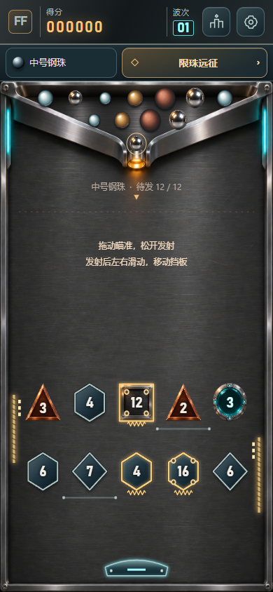

# 磁核弹阵 · Flux Foundry

一颗弹珠，一块挡板。竖版物理弹射游戏：每次撞击数字减1，归零消除；左右移动挡板救球，撞中宝物立即生效。

**[在线游玩](https://ax2.github.io/flux-foundry/)** · **[Windows 下载](https://github.com/ax2/flux-foundry/releases)** · MIT



## v0.15.0 双柱空弹与稀疏残局

使用与v0.9.0逐字节一致的原始PNG及原始分辨率，不压缩、不缩图、不转WebP；保留真实加载进度、备用首帧和重试。

两条约20.8秒首球已分别定位：只剩1–2块时更早准备既有机械面校正；反弹柱反复空弹时可见回缩，原球完全通过后复位。两例降至10.10/15.46秒，1872首球最长19.50秒。无限接球、原球自然落底、既有供能上限与存档保留。已发布[v0.15.0](https://github.com/ax2/flux-foundry/releases/tag/v0.15.0)，验证证据见[Stage-16日志](docs/iterations/Stage-16/worklog.md)。

## 自然回放与稳定进度

v0.14.0为上一版；当前修复继续保留已存星级。Stage-08的简化挡板玩法纳入本轮，v0.8.0未独立发布。

- 正式三星路线只使用合法选珠与瞄准，原球自然落底；不再调用隐藏收球。
- 无进展的重复球路触发可见挡板微倾，改变下一次碰撞法线；接球次数不设上限。
- 稳定存档键保留旧版历史成绩，设置中可查看；规则更新后的星级独立认证。

## 简化玩法

- **移动挡板**：飞行时在场地左右滑动或移动鼠标，偏心接球可以改变反射方向；键盘左右也能控制。
- **顶部导航**：设置、本机排行；远征/挑战入口使用金属卡片。底部操作栏已移除。
- **击中即生效的宝物**：♥生命+1（最多额外3颗，待发仓最多12颗）；↔挡板加长（本颗14秒）；●大慢球（本颗变大12秒，拾取时减速）。重复宝物续时，漏球后清除临时效果。
- **移动积木**：带轨道的积木横向移动，碰撞考虑积木本身的速度。
- **更强气流**：物理作用2.4倍、雾流更明显，保留不规则轮廓与羽化边界。
- **自动推进**：三选一、主动磁场/脉冲、收球和加速均移除，不再打断对局选择增强。

## 操作与规则

拖动瞄准，松开发射；飞行中左右滑动控制挡板。按空格发射，方向键控制，P/Esc打开设置。设置里提供声音、特效、玩法、重开与继续。菜单会暂停球、运动积木与宝物时钟。

保留4材质×3尺寸、6种积木形状、26关、每日试炼与限珠远征。初始有限库存显示在原三角出球仓内，可调序、改装下一颗；场内始终只有一颗活动弹珠，没有拖尾和预测轨迹。每击严格减1，特殊积木通过外框识别。金色线圈与侧壁段供能，绿色开关开闸，紫色核心为关卡目标，风阀击碎后反转风向。

弹珠没有寿命限制，漏过挡板完整落底才回收；完成目标时挡板放行再结算。卡在积木面上时，积木让位让原球受重力落底。重复接球且没有有效命中时挡板微倾打破球路，不限制接球次数。本机排行记录此设备完成对局的前十名，尚未提供联网排行。

## 交付与验证

Windows x64：`Flux-Foundry-0.15.0-Windows-x64.exe` 便携启动，本地保留 `releases/v0.15.0/win-unpacked/` 完整运行目录，无游戏ZIP。手机为触屏Web/PWA，首次联网加载后可离线重开；未交付APK/iOS原生包。Windows未签名，实体手机/低端性能仍待验收。

本轮97项逻辑（含52套严格自然三星回放）、121界面、22加载、原图校验、Windows目录与EXE启动通过；4局真实自动触控全自然通关，5颗/77接球，整局最长无命中12.70秒。算法/触控并非真人胜率或实体手机性能。完整原图3.40MB，低带宽就绪仍会较慢，加载进度持续显示。

[本轮评估](docs/iterations/Stage-16/assessment.md) · [工作日志](docs/iterations/Stage-16/worklog.md)

## 开发

```sh
npm ci
npm run dev
npm test
npm run build
npm run test:browser
npm run package:win
```

开发地址 http://localhost:5186 。代码 `D:/work/games/flux-foundry`，持续档案 `C:/Users/ax2/Documents/技术博客/flux-foundry`。历史阶段独立保留，不把旧玩法的验收结果套到当前版本。

按阶段发布；每周检查实际变更与验证结果，有可发布内容才发版本，不发布空版本，不覆盖已发布标签/资产。

源码MIT。背景、图集为项目原创生成，音效由Web Audio合成，无原作角色、平台UI、广告、账号或追踪。素材记录见 [assets.md](docs/design/assets.md)。
