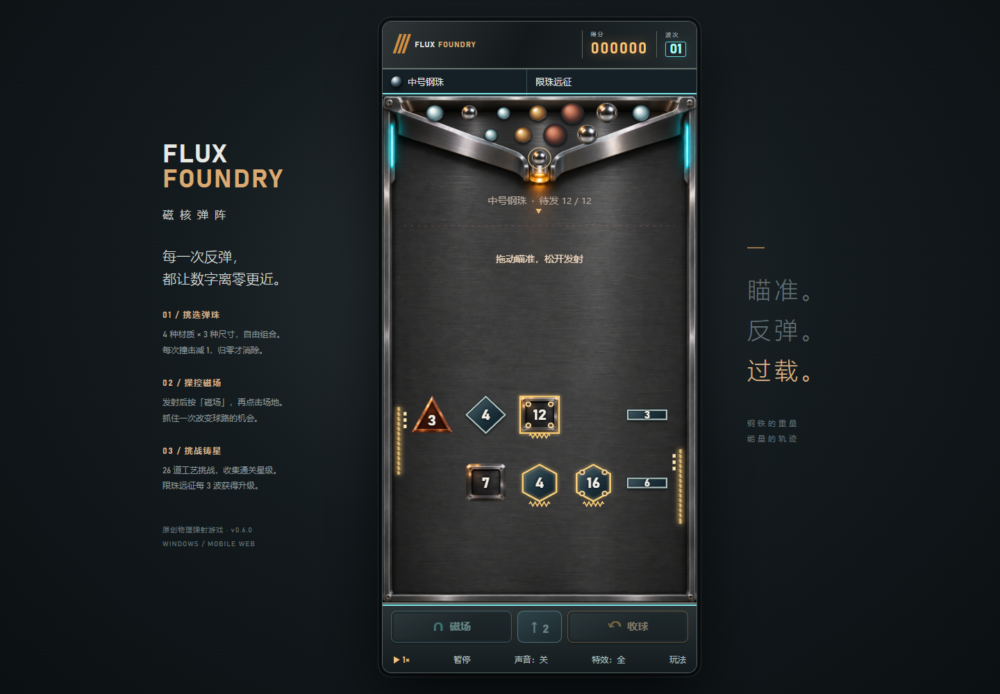

# 磁核弹阵 · Flux Foundry

一款竖版、单球、物理反弹游戏。钢珠掠过机加工金属，每次撞击使数字减一，归零才会消除；借助磁场、上冲与蓄能装置，延续每一颗弹珠的球路。

**在线游玩：[ax2.github.io/flux-foundry](https://ax2.github.io/flux-foundry/)** · **[Windows 下载](https://github.com/ax2/flux-foundry/releases)** · MIT



## v0.6.0 主动操控更新

- 底部完全开放。飞行中点目标位置施加定向气脉冲，或点↑/空格向上推；所有材质可用，每球初始2次，每8命中补1次、最多补2次。
- ▶切换1/2/4倍速；使用技能自动恢复1倍，物理保持固定步长。
- 清理场内和操作区小字，以图标与余量显示操作，详细规则在帮助中。
- 三选一重做：精密回弹同时提高蓄能供能，脉冲扩容增加每颗操作次数，高压气室增强推力；金/青/紫卡片显示升级前后差异。
- 新增风阀借力、双锁蓄能室，共26关，52套正常/镜像三星路线。[阶段设计](docs/iterations/Stage-06/design.md) / [更新说明](docs/iterations/Stage-06/v0.6.0.md)。

## 游戏内容

- **6种积木形状**：方形、三角、圆形、菱形、六边形、长条，碰撞与可见轮廓一致。耐久从1、2、3到中段5–12、后段15–24形成阶梯；低耐久开路，高耐久保留反射支点。
- **动力与机关**：金色线圈积木沿碰撞法向补充能量，有调节上限；绿色开关全部击碎才打开闸门；紫色核心关只需摧毁核心。始终每次有效撞击减1。
- **自动脱困**：检测局部停滞/持续低速接触/同一被动表面重复反弹，先施加可见气脉冲；再次受困时积木与机关退让，弹珠受重力落入底部。没有球龄上限，不在半途删除弹珠。
- **三角出球仓库存**：每局固定5–12颗（按挑战关卡），远征固定12颗；剩余弹珠直接显示在原有三角出球仓内，不再另占一行，可点选调到下一发。工坊只改装下一颗，发射后锁定。收球消耗当前弹珠，不补库存。
- **26关 + 每日试炼 + 限珠远征**：清场与核心目标交替，星级、重试、下一关、本地记录；每日按北京时间固定布局及镜像，支持离线。v0.4调整气流与关卡，旧版星级保留原存储但不套用新版。
- **更清爽的积木与气流**：积木只显示数字，功能通过双框/线圈/阀轮区分；不规则气雾与细流替代箭头，受力边缘平滑过渡。
- **新增补能与策略**：左右金色侧壁段每球每段3次补能，亮点显示余量；上升风井、风阀翻转、双核心与窄门组合。
- **4材质×3尺寸**：钢/黄铜/陶瓷/橡胶；小中大直径18/24/32。质量按体积与密度，初始发射动能相同，重力一致；只有钢珠可被磁场吸引。数值为游戏参数。

[本轮平衡与实玩评估](docs/iterations/Stage-04/assessment.md)记录全12种弹珠的自然落底、关闭侧壁补能的对照、完整UI对局及48套三星解。历史形状/数值/位置对照见Stage-03。模拟不能替代真实玩家平衡验收。

## 玩法

- 在场地内拖动瞄准，松开手指或鼠标发射当前待发弹珠；弹珠完整落入底部回收槽才自动回收，没有飞行时间限制。若停在积木面上，自动脱困会介入，也可主动「收球」。
- 所有积木每次有效撞击只减 1，归零才消除；三角积木按斜面反射，青色电容没有连锁扣血。
- 发射后按「磁场」，再点击场地部署吸引场，每轮一次，仅钢珠适用。
- 每 3 波从回弹效率、磁场吸引力、磁场时长中选择升级。
- 限珠远征每轮剩余积木上升；碰到发射口下方警戒线即失败。「收球」提前结束本轮；限珠远征推进积木阵，挑战模式用掉本次发射。
- 键盘：左右键瞄准，空格发射/飞行中上冲，M 选磁场（再按 M 在中央部署），R 收球，P/Esc 暂停。
- 不显示飞行轨迹、预测路径或拖尾。重力决定自由飞行，普通碰撞损耗法向动能、保持切向速度；弹簧积木明确供能，磁场/气流/救援作为显式外力。
- 支持声音开关、简化特效、自动失焦暂停、最佳分数本地保存。

## 运行与平台

Windows x64：Release 的 `Flux-Foundry-0.6.0-Windows-x64.exe` 为便携启动程序，直接双击。完整运行目录保留在本地 `releases/v0.6.0/win-unpacked/`；没有生成游戏 ZIP。初版未签名。

手机：打开在线地址，竖屏触控游玩。首次联网加载后可离线重开；支持的浏览器可添加到主屏幕。此阶段交付手机 Web/PWA，未交付 Android APK 或 iOS 原生安装包。真实 Android/iOS 设备兼容性与手感尚待验收。

开发需要 Node.js 22.12+ 与 npm：

```sh
npm ci
npm run dev
npm test
npm run build
npm run desktop
npm run package:win
```

开发服务默认 http://localhost:5186 。若使用 Windows 目录联接，构建配置会解析真实根目录。首次安装 Electron 需要联网下载官方运行时。

## 项目结构

`src/physics.ts` 几何碰撞；`src/game.ts` 固定步长模拟；`src/render.ts` 渲染；`src/main.ts` 输入与 UI；`public/assets/` 原创生成美术；`docs/` 持续设计、迭代和验证记录。

## 版本节奏

按阶段迭代，计划每周检查一次可发布进展。有实际变更且验证通过才发新版本，不为凑日期发布空版本。每个版本记录变更、测试证据、已知限制和 Windows EXE 校验值。版本标签触发 Windows 构建及 Release；main 更新部署手机网页。

Stage-06 / v0.6.0：开放底部、定向操控、加速与增强卡片。后续方向：真实设备实测、玩家反馈调参、更多升级组合与关卡包。尚未实现的内容不作为当前功能宣传。

## 素材与许可

源码采用 MIT。背景与图集由本项目使用内置 Image Gen 原创生成，不含截图中的角色、平台 UI、音频或其他原作资源；项目方拥有的可许可权利按 MIT 提供。音效由 Web Audio 合成，无远程内容、广告、账号或追踪。资产来源与生成提示见 [素材记录](docs/design/assets.md)。
