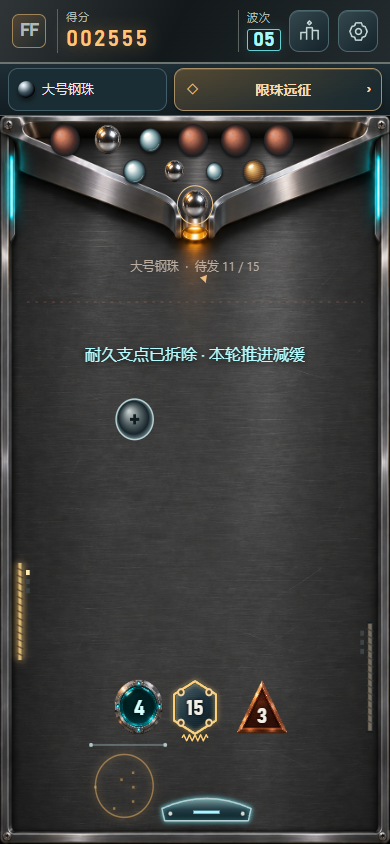

# 磁核弹阵 · Flux Foundry

一颗弹珠，一块挡板。竖版物理弹射游戏：每次撞击数字减1，归零消除；左右移动挡板救球，撞中宝物立即生效。

**[在线游玩](https://ax2.github.io/flux-foundry/)** · **[Windows 下载](https://github.com/ax2/flux-foundry/releases)** · MIT



## v0.23.0 远征低位积木

挡板会更准确地预报低位移动积木残局的接球。远征还有一排低位积木时，靠墙首次接球也可以提前准备有效反弹。固定回放和实际触控结果见 [Stage-27 评估](docs/iterations/Stage-27/assessment.md)。

[v0.23.0 Windows 下载](https://github.com/ax2/flux-foundry/releases/tag/v0.23.0) · [手机与浏览器试玩](https://ax2.github.io/flux-foundry/)

## v0.22.0 风井与横风残局

第 19 关的风井保留原风力并平移。第 22 关在只剩同侧低位核心时，挡板可为靠墙球提前准备能命中的真实反弹。两轮的取舍和验收见 [风井](docs/iterations/Stage-24/assessment.md) 与 [横风残局](docs/iterations/Stage-25/assessment.md)。

[v0.22.0 Windows 下载](https://github.com/ax2/flux-foundry/releases/tag/v0.22.0) · [手机与浏览器试玩](https://ax2.github.io/flux-foundry/)

## v0.21.0 侧边回弹校正

贴边连续空接时，只有普通反弹预测会落空、另一条真实反弹能扣数，才提前准备挡板。第12关两条18.50秒路线降至11.66秒，合法续打仍三星，耗珠4/2→2/3。原PNG、无限接球、自然完整落底和现有进度保持。144逻辑、6336固定输入、原52套自然三星、8套新增续打与4局触控通过。[v0.21.0已公开](https://github.com/ax2/flux-foundry/releases/tag/v0.21.0)，完整源码CI、Pages、Windows及公开EXE下载校验/实际启动通过。[实际取舍与验证](docs/iterations/Stage-23/assessment.md)。

### v0.20.0 更新与进度保护

设置显示当前版本和更新状态，整局结束后由玩家主动切换；更新前确认保存，多页成绩合并且其他页面不自动刷新。离线缓存复用已下载的原图，画质与物理保持。[v0.20.0已公开](https://github.com/ax2/flux-foundry/releases/tag/v0.20.0)，138逻辑/30原生更新专项、121界面/14反馈/22加载、6336精确物理对照、3局自动触控及完整标签CI通过，公开EXE下载校验/实际启动通过。详见[Stage-21设计与验证](docs/iterations/Stage-21/assessment.md)。

首次从v0.19及更早PWA升级，请在完成当前局后关闭本站所有页签/游戏窗口再打开一次；此后使用设置内更新流程。

### v0.19.0 移动低块与大慢球脱困

原始PNG及分辨率保持，不压缩、不缩图、不转WebP。低位移动积木上方反复越过时减少多余补能；大慢球让重珠连续够不到高处时，在真实接触中逐次蓄能脱困，单次供能上限不变，无接触不加速。

133逻辑/52自然三星、6336固定样本自然结束且逐行最长间隔未增。两条19.5秒路线降至12.08/14.74秒，保持原耗珠和三星；3局触控全通关，最长10.06秒。仅镜像3关自然路线更新为同角度一发通关。详见[Stage-20验证](docs/iterations/Stage-20/assessment.md)。[v0.19.0已公开](https://github.com/ax2/flux-foundry/releases/tag/v0.19.0)，完整CI/Windows/Pages、公网及公开EXE下载校验/启动通过。该版本尚无可见更新提示；v0.20.0补充后续更新流程。

## 自然回放与稳定进度

v0.20.0为上一公开版；当前修复继续保留已存星级。Stage-08的简化挡板玩法纳入当前规则，v0.8.0未独立发布。

- 正式三星路线只使用合法选珠与瞄准，原球自然落底；不再调用隐藏收球。
- 无进展的重复球路触发可见挡板微倾，改变下一次碰撞法线；接球次数不设上限。
- 稳定存档键保留旧版历史成绩，设置中可查看；规则更新后的星级独立认证。

## 简化玩法

- **移动挡板**：飞行时在场地左右滑动或移动鼠标，偏心接球可以改变反射方向；键盘左右也能控制。
- **顶部导航**：设置、本机排行；远征/挑战入口使用金属卡片。底部操作栏已移除。
- **击中即生效的宝物**：♥生命+1（最多额外3颗，待发仓最多12颗）；↔挡板加长（本颗14秒）；●大慢球（本颗变大12秒，拾取时减速）。重复宝物续时，漏球后清除临时效果。
- **移动积木**：带轨道的积木横向移动，碰撞考虑积木本身的速度。
- **更强气流**：物理作用2.4倍、雾流更明显，保留不规则轮廓与羽化边界。
- **自动推进**：三选一、主动磁场/脉冲、收球和加速均移除，不再打断对局选择增强。

## 操作与规则

拖动瞄准，松开发射；飞行中左右滑动控制挡板。按空格发射，方向键控制，P/Esc打开设置。设置里提供声音、特效、玩法、重开与继续。菜单会暂停球、运动积木与宝物时钟。

保留4材质×3尺寸、6种积木形状、26关、每日试炼与限珠远征。初始有限库存显示在原三角出球仓内，可调序、改装下一颗；场内始终只有一颗活动弹珠，没有拖尾和预测轨迹。每击严格减1，特殊积木通过外框识别。金色线圈与侧壁段供能，绿色开关开闸，紫色核心为关卡目标，风阀击碎后反转风向。

弹珠没有寿命限制，漏过挡板完整落底才回收；完成目标时挡板放行再结算。卡在积木面上时，积木让位让原球受重力落底。重复接球且没有有效命中时挡板微倾打破球路，不限制接球次数。本机排行记录此设备完成对局的前十名，尚未提供联网排行。

## 交付与验证

Windows x64 便携版为 `Flux-Foundry-0.23.0-Windows-x64.exe`。本地 `releases/v0.23.0/` 保留完整 `win-unpacked` 运行目录和 EXE。手机为触屏 Web/PWA，首次联网加载后可离线重开。Windows 未签名，实体手机及低端性能仍待验收。

当前验证见 Stage-27，历史发布资格见各阶段评估。PCM 渲染和自动触控覆盖软件层。实体手机、真实扬声器与人耳听感待验。完整原图约 3.40 MB，低带宽下会逐步显示加载进度。

[本轮评估](docs/iterations/Stage-18/assessment.md) · [工作日志](docs/iterations/Stage-18/worklog.md) · [音效预览](docs/iterations/Stage-18/cue-preview.wav)

## 开发

```sh
npm ci
npm run dev
npm test
npm run build
npm run test:browser
npm run package:win
```

开发地址 http://localhost:5186 。代码 `D:/work/games/flux-foundry`，持续档案 `C:/Users/ax2/Documents/技术博客/flux-foundry`。历史阶段独立保留，不把旧玩法的验收结果套到当前版本。

按阶段发布；每周检查实际变更与验证结果，有可发布内容才发版本，不发布空版本，不覆盖已发布标签/资产。

源码MIT。背景、图集为项目原创生成，音效由Web Audio合成，无原作角色、平台UI、广告、账号或追踪。素材记录见 [assets.md](docs/design/assets.md)。
