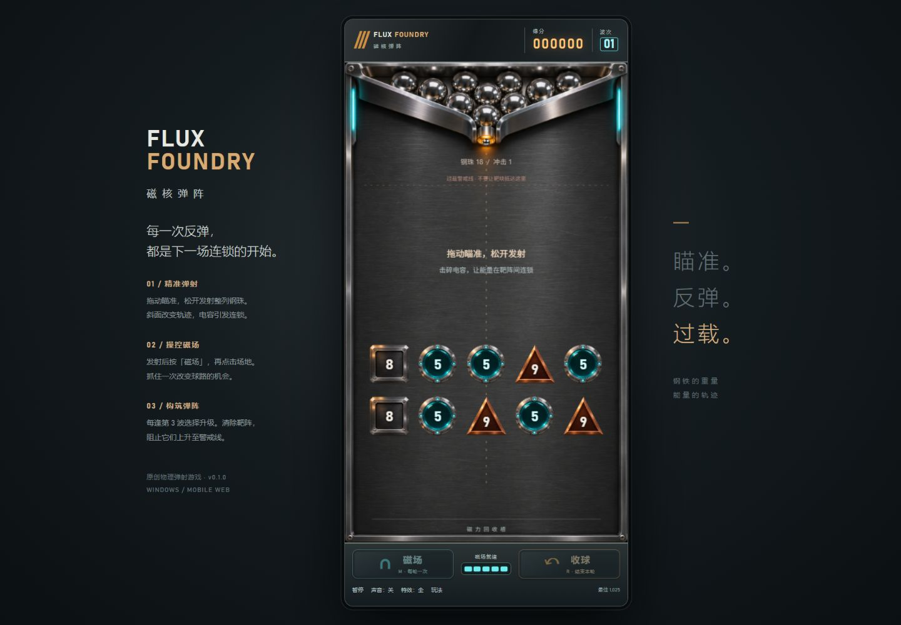

# 磁核弹阵 · Flux Foundry

一款竖版、多球、物理反弹游戏。钢珠掠过机加工金属，电容在靶阵间连锁放电；用一次主动磁场，改变整轮的球路。

**在线游玩：[ax2.github.io/flux-foundry](https://ax2.github.io/flux-foundry/)** · **[Windows 下载](https://github.com/ax2/flux-foundry/releases)** · MIT



## 玩法

- 在场地内拖动瞄准，松开手指或鼠标发射整列钢珠；钢珠落到底部自动回收。
- 圆形青色电容被击破会伤害周边靶块，三角铜靶按斜面反射。
- 发射后按「磁场」，再点击场地部署吸引场，每轮一次。
- 每 3 波从钢珠数量、碰撞伤害、磁场时长中选择升级。
- 每轮剩余靶块上升；碰到发射口下方警戒线即失败。「收球」会提前结束本轮，并推进靶阵。
- 键盘：左右键瞄准，空格发射，M 选磁场（再按 M 在中央部署），R 收球，P/Esc 暂停。
- 支持声音开关、简化特效、自动失焦暂停、最佳分数本地保存。

## 运行与平台

Windows x64：Release 的 `Flux-Foundry-0.1.0-Windows-x64.exe` 为便携启动程序，直接双击。完整运行目录保留在本地 `releases/v0.1.0/win-unpacked/`；没有生成游戏 ZIP。初版未签名。

手机：打开在线地址，竖屏触控游玩。首次联网加载后可离线重开；支持的浏览器可添加到主屏幕。此阶段交付手机 Web/PWA，未交付 Android APK 或 iOS 原生安装包。真实 Android/iOS 设备兼容性与手感尚待验收。

开发需要 Node.js 22.12+ 与 npm：

```sh
npm ci
npm run dev
npm test
npm run build
npm run desktop
npm run package:win
```

开发服务默认 http://localhost:5186 。若使用 Windows 目录联接，构建配置会解析真实根目录。首次安装 Electron 需要联网下载官方运行时。

## 项目结构

`src/physics.ts` 几何碰撞；`src/game.ts` 固定步长模拟；`src/render.ts` 渲染；`src/main.ts` 输入与 UI；`public/assets/` 原创生成美术；`docs/` 持续设计、迭代和验证记录。

## 版本节奏

按阶段迭代，计划每周检查一次可发布进展。有实际变更且验证通过才发新版本，不为凑日期发布空版本。每个版本记录变更、测试证据、已知限制和 Windows EXE 校验值。版本标签触发 Windows 构建及 Release；main 更新部署手机网页。

Stage-01 / v0.1.0：首个可玩版本。后续方向：设备实测与数值平衡、目标弱点/相位机关、更多升级组合、独立挑战模式。尚未实现的内容不作为当前功能宣传。

## 素材与许可

源码采用 MIT。背景与图集由本项目使用内置 Image Gen 原创生成，不含截图中的角色、平台 UI、音频或其他原作资源；项目方拥有的可许可权利按 MIT 提供。音效由 Web Audio 合成，无远程内容、广告、账号或追踪。资产来源与生成提示见 [素材记录](docs/design/assets.md)。
